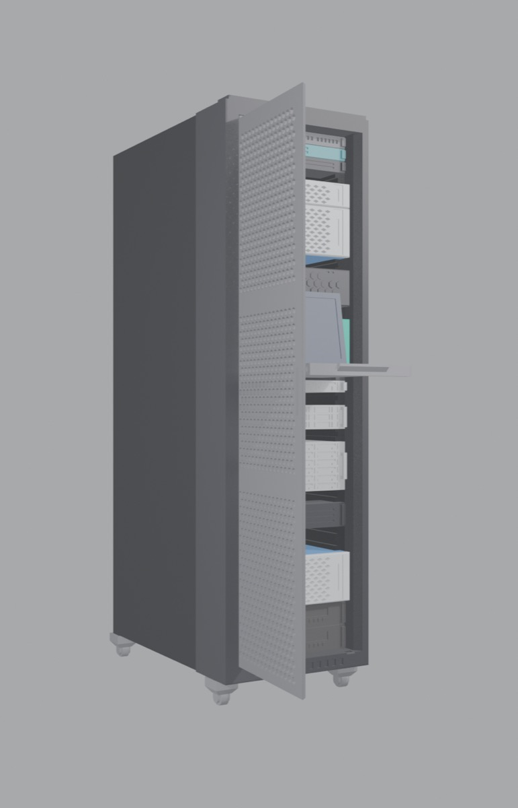
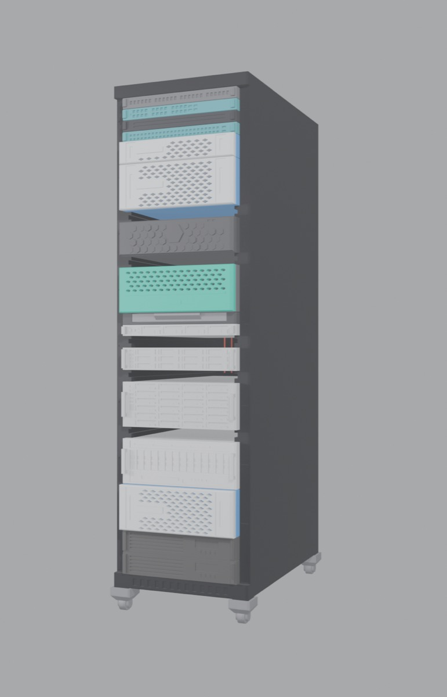
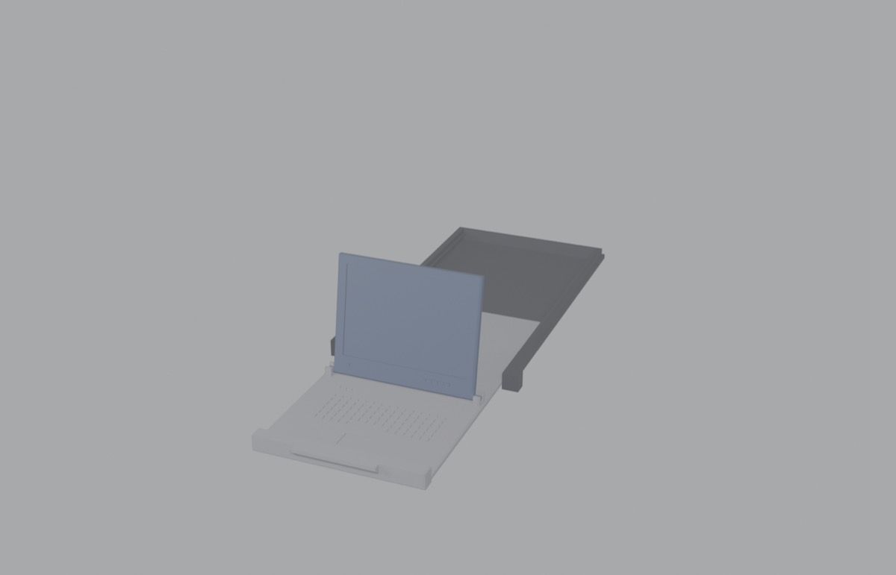

# 1:8 scale 42U rack

## What this is

A 1:8 scale 42U server rack with slide-in servers, designed for a Bambu Lab P1S (0.4 mm nozzle, PLA). The rack measures 70.7 x 116 x 250 mm. 1U equals 5.56 mm.

Reference photos used for styling are in `~/Pictures/servers/`. No logos or brand names appear on any part.





## How the parts go together

The rack has a rail groove on both side walls for every U position. Each server consists of two prints:
*   A generic chassis (`stl/chassis/`) that slides into the grooves on side rail tongues.
*   A snap-on front (`stl/fronts/`) that pushes onto 2 pegs (1U) or 4 pegs (2U and taller) on the chassis front.

Any front fits any chassis of the same height. Fronts are 4 mm thick; their ears stop against the rack. Some fronts take a clip-on bezel (`stl/bezels/`) that pushes onto two pegs on the front's ears. Fronts without a bezel have handles instead. The bezel pockets have no clearance (0.00 mm per side, picked from the bezel coupon test); the chassis-to-front pegs use 0.12 mm per side.

For a second rack there is a one-piece option: `rack_42u_with_frame` combines the rack and the door frame into a single print. The frame ring is part of the rack's front, so there are no clip-on flanges and no grip fit to tune. The two-piece version stays available.

## Parts list

### stl/
Print on its back: rear panel on the bed, front facing up. No supports.

| File | Notes |
| :--- | :--- |
| `rack_42u` | The rack (70.7 x 249.8 mm on the bed, 116 mm tall). Takes the clip-on `door_frame`. |
| `rack_42u_with_frame` | One-piece rack and door frame (70.7 x 249.8 mm on the bed, about 126 mm tall). Replaces both `rack_42u` and `door_frame`. Same rack settings. No U tick marks on the wall fronts (the clip-on frame hid them anyway). |

### stl/chassis/
Print flat, as exported.

| File | Description |
| :--- | :--- |
| `chassis_1u_12mm` | blank_1u |
| `chassis_2u_12mm` | blank_2u |
| `chassis_1u_20mm` | patch_panel_1u |
| `chassis_1u_50mm` | switch_1u, switch_48_1u |
| `chassis_2u_80mm` | ups_2u (two in the layout) |
| `chassis_1u_95mm` | storage_server_1u |
| `chassis_3u_95mm` | flash_array_3u |
| `chassis_2u_100mm` | storage_server_2u, unified_controller_2u |
| `chassis_4u_100mm` | disk_shelf_4u, hybrid_array_4u, unified_controller_4u |
| `chassis_4u_105mm` | storage_server_4u, gpu_node_4u |
| `chassis_4u_100mm_gpu_open` | gpu_node_4u alternative: open top (lid off) with simplified HGX A100 interior: 14 PCIe cards with latch bars, 2 CPUs + DIMMs, 2x4 GPU modules, busbar, NVSwitch heatsinks, 5 fans. Same rails and pegs, any 4U front fits. Made by `gpu_chassis.py` |

### stl/fronts/
Print flat, face up, as exported.

| File | Style / Notes |
| :--- | :--- |
| `flash_array_3u_front` | Pure Storage FlashArray style; takes a bezel |
| `hybrid_array_4u_front` | Nimble style; bezel |
| `unified_controller_2u_front` | NetApp AFF style; bezel |
| `unified_controller_4u_front` | NetApp AFF style; bezel |
| `disk_shelf_4u_front` | NetApp disk shelf style; bezel |
| `storage_server_1u_front` | Supermicro style, loop handles, no bezel |
| `storage_server_2u_front` | Supermicro style, loop handles, no bezel |
| `storage_server_4u_front` | Supermicro style, loop handles, no bezel |
| `switch_1u_front` | 24-port switch; grip handles, no bezel |
| `switch_48_1u_front` | 48-port switch with 2 uplinks (from the A100 rack photos); grip handles, no bezel |
| `gpu_node_4u_front` | HGX A100-style 8-GPU node: 14 PCIe brackets, vent band, management strip (from ~/Pictures/work_a100_systems/); loop handles, no bezel |
| `patch_panel_1u_front` | Grip handles, no bezel |
| `ups_2u_front` | Grip handles, no bezel |
| `blank_1u_front` | Grip handles, no bezel |
| `blank_2u_front` | Grip handles, no bezel |

### stl/bezels/
Print flat, pattern up.

| File | Description |
| :--- | :--- |
| `flash_array_3u_bezel` | Honeycomb with a blank hexagon emblem |
| `hybrid_array_4u_bezel` | Mesh over a plain lower panel |
| `unified_controller_2u_bezel` | Diamond perforations |
| `unified_controller_4u_bezel` | Diamond perforations |
| `disk_shelf_4u_bezel` | Same diamond bezel as the 4U controller |

### stl/bezels_glow_test/
Optional experiment.

| File | Description |
| :--- | :--- |
| `flash_array_3u_bezel_glow` | Bezel with 14 through slots |
| `flash_array_3u_glow_shim` | 0.6 mm shim, print in accent colour (orange). Put the shim on the ear pegs first, then the bezel. |

### stl/kvm/
1U console drawer, three prints.

| File | Description |
| :--- | :--- |
| `kvm_shell` | Slides into the rack like a chassis, has the ears |
| `kvm_drawer` | Keyboard deck, slides into the shell from the front under two hold-down ridges |
| `kvm_screen` | Print flat, screen side up; octagonal pins drop into cradles at the back of the keyboard deck |
| `kvm_screen_keeper` | Optional, print 2 (fits either side). Tiny cap glued on top of each screen cradle post so the screen's pins can't lift out. Print as exported (flat plate down). Only 0.4 mm thick because the unit above sits just over the posts. |

### stl/extras/
None require a rack reprint.

| File | Notes |
| :--- | :--- |
| `door_frame` | Print front face down (73.7 x 248.3 mm on bed, 28 mm tall). Clips onto the front of the rack. |
| `door` | Print flat (62.8 x 238 mm). Perforated lift-off door. |
| `door_cray` | Optional swap for `door`, same frame and hinges. Print flat (62.8 x 238 mm). Wavy slot pattern in the style of a Cray CS-Storm door, with a blank raised badge at the top left (paint it blue, no logo). |
| `pdu` | Print 2, face down. Hangs on rear vent slots. |
| `caster` | Print 4, upside down as exported. Push onto plinth legs. Decorative, do not roll. Raise rack 8.8 mm. |

## Print settings

*   **Material:** PLA
*   **Nozzle:** 0.4 mm
*   **Layer Height:** 0.2 mm
*   **Supports:** None. Every STL is already in its print orientation.
*   **Rack Settings:** 3 walls, 15% infill, skirt instead of brim.
*   **Long Parts (Door Frame/Door):** Use a skirt. Keep them straight on the bed along one axis.
*   **Detail:** Every face detail is at least 0.8 mm wide with gaps of at least 0.8 mm.

## Print these tests first

All quick tests:

1.  **Snap-fit test:** `chassis_1u_12mm` plus `blank_1u_front`. The front should push on by hand and stay on when you pull the unit out of the rack by its handles.
2.  **Door frame grip:** `stl/fit_test/door_frame_grip_test` (a 12 mm tall slice of the door frame). It should push onto the bottom front of the rack and stay put.
3.  **Caster:** Print one caster.

*Note: The older rack-slice, sled, and bezel tests in `stl/fit_test/` were already printed and confirmed.*

## Assembly notes

**KVM Drawer:**
1.  Slide `kvm_shell` into the rack.
2.  Slide `kvm_drawer` into the shell from the front under two hold-down ridges.
3.  Drop the two octagonal pins of `kvm_screen` into the open-top cradles at the back of the keyboard deck.
4.  To use: Pull the drawer out about 56 mm, flip the screen up. It leans back about 10 degrees against a stop wall. The drawer has no end stop and can be pulled all the way out.

**One-piece rack:**
Either door (`door` or `door_cray`) hangs on it exactly as on the clip-on frame: same hinge sockets, same latch notch. Servers, bezels, KVM, PDUs and casters fit it unchanged. Skip the door frame grip test.

**Door Frame:**
Clips onto the front of the rack. Two side flanges grip the rack sides; a top flange rests on the rack top.

**Door:**
To hang: Put the long top pin up into the top socket, lift, swing the bottom in, and let it drop onto the bottom pin. It opens to about 95 degrees. A small tooth under the free end drops into a notch in the frame to hold the door shut; lift the handle side slightly to open.

**PDU:**
Push the two hooks through the outermost slot column on the rear vent slots and slide the strip down.

**Casters:**
Push one onto each plinth leg. A drop of glue helps if they are loose.

## Tuning the fits

Edit these values in the source code, then rebuild:

*   `PEG_CLEAR` in `rack_lib.py`: Chassis pegs into the front (default 0.12).
*   `BEZEL_PEG_CLEAR` in `rack_lib.py`: Bezel onto the front's ear pegs (default 0.00, from the coupon test).
*   `SIDE_CLEAR` in `rack_lib.py`: Server to rack wall (default 0.35).
*   `GRIP` in `extras.py`: Door frame flange squeeze (default 0.10 per side). Raise if loose, lower if too tight.
*   `CUP_CLEAR` in `extras.py`: Caster cup (default 0.15).

## Rebuilding

Build every STL and run collision checks:
```bash
.venv/bin/python build.py
```

Rebuild older fit tests:
```bash
.venv/bin/python test_fit.py
```

Generate preview images (scenes in `build/`: `preview_parts`, `preview_bezel_parts`, `preview_door_parts`, `preview_open_parts`, `kvm_parts`; images land in `previews/`):
```bash
/Applications/Blender.app/Contents/MacOS/Blender -b --python render.py -- preview_door_parts preview_door
```

**Folder Structure:**
*   `designs/`: Fronts and bezels as data files.
*   `panels/`: Door, PDU, and KVM layouts.
*   `stl/`: Printable files.
*   `previews/`: Rendered images and `.blend` files.
*   `build/`: Intermediate preview parts.
*   `jobs/`: Briefs and logs for local model workers.
*   `archive/`: Older design generations and earlier one-piece server STLs.

## Adding or changing a front

1.  Write `designs/NAME.py` following `FACE_SPEC.md`. Optionally write `designs/NAME_bezel.py`.
2.  Check it: `.venv/bin/python check_face.py designs/NAME.py`
3.  Add it to `layout.json`.
4.  Rebuild.

Door, PDU, and KVM layouts follow `PANEL_SPEC.md` and live in `panels/`.

## About this repository

This remote holds the parametric generator: every printable STL in this project is produced by the Python code here from the data files in `designs/` and `panels/` — no manual CAD. Generated output (`stl/`, `previews/`, `build/`) and working scratch (`jobs/`, `archive/`, `.venv/`) are gitignored; rebuild them with `.venv/bin/python build.py`. The print-ready STL pack is published separately on MakerWorld (link once live).